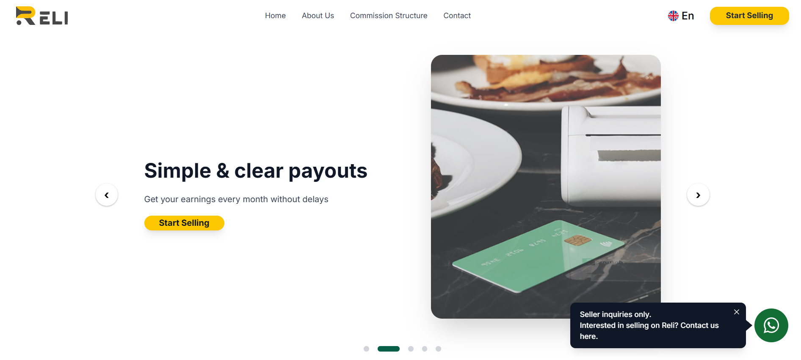

# ReliGroup Landing Page

A corporate landing page developed for **ReliGroup**. The project was built independently, covering the complete frontend development process — from implementing the user interface to responsive layouts and interactive elements.

## 🚀 About the Project

This project is a corporate landing page created for ReliGroup to present the company, its services, and its business activities.

I independently developed the entire frontend, including the page structure, visual components, responsive design, navigation, and interactive sections.

The main goal was to create a modern, user-friendly, and responsive website that represents the company's identity and provides visitors with a convenient browsing experience.

## ✨ Features

- Modern corporate landing page
- Responsive design for desktop, tablet, and mobile devices
- Reusable React components
- Interactive navigation and smooth scrolling
- Multilingual support with i18next
- Form handling and validation with Formik and Yup
- Notifications with React Toastify
- Interactive sliders and carousels
- Adaptive UI components using Material UI
- SCSS-based styling

## 🛠 Tech Stack

| Technology | Purpose |
|---|---|
| React 18 | Frontend development |
| React Router DOM | Routing |
| JavaScript | Application logic |
| SCSS / Sass | Styling |
| Material UI | UI components |
| Emotion | Component styling |
| Axios | HTTP requests |
| Formik | Form management |
| Yup | Form validation |
| i18next | Internationalization |
| React-i18next | React internationalization |
| React Responsive | Responsive behavior |
| React Scroll | Smooth scrolling |
| React Slick / Slick Carousel | Sliders and carousels |
| Swiper | Interactive sliders |
| React Toastify | Notifications |

## 📸 Screenshots

Add project screenshots to the `public` folder:



## 💡 My Contribution

**Role: Frontend Developer**

I was fully responsible for the frontend development of this project.

My responsibilities included:

- Developing the complete landing page independently
- Implementing the website structure and UI components
- Creating responsive layouts for different screen sizes
- Developing interactive elements and navigation
- Implementing multilingual functionality
- Working with forms and validation
- Integrating sliders, carousels, and notifications
- Organizing the frontend code and project structure

## ⚙️ Installation & Setup

Clone the repository:

```bash
git clone <REPOSITORY_URL>
```

Navigate to the project directory:

```bash
cd <PROJECT_FOLDER>
```

Install dependencies:

```bash
npm install
```

Start the development server:

```bash
npm start
```

If the project uses Vite, run:

```bash
npm run dev
```

## 🎯 What I Learned

- Building a complete corporate website independently
- Structuring and organizing React applications
- Creating reusable and maintainable components
- Implementing responsive interfaces
- Working with internationalization in React
- Managing forms and validation
- Integrating interactive UI libraries
- Improving frontend development workflow

## 🔗 Links

- **Company:** ReliGroup
- **Live Demo:** <https://info.reli.one/?language=en>
